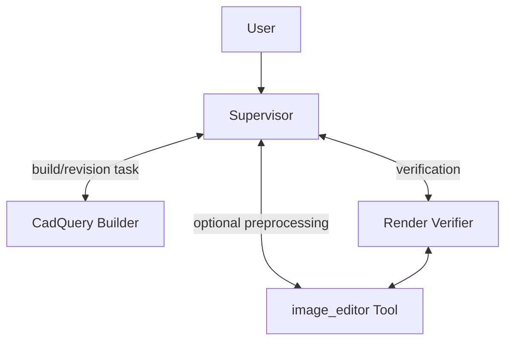
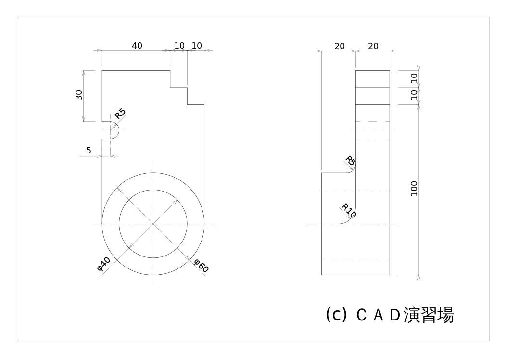
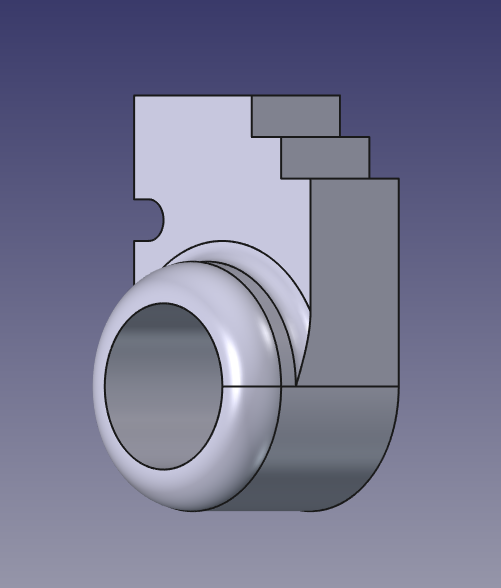

# agent3dify

A tool for converting 2D drawings into 3D models using a combination of AI agents.

The project now includes an interactive CAD workbench: upload one combined drawing or up to three orthographic views, watch agent/tool activity as it runs, inspect a live STL preview, and send revision instructions into the same workspace. Sessions and generated artifacts are stored locally under `drawing_to_cad_workspace/web/`.

This project is a development of [cad3dify](https://github.com/neka-nat/cad3dify) to an agent-based system. The root agent uses the following tools and subagents to operate:

- image_editor Tool
- CadQuery Builder
- Render Verifier

The image_editor Tool is an optional preprocessing tool: `extract_outline` and `custom` use image editing, while `extract_view` uses Gemini image understanding to detect a target view and crop it deterministically. The Render Verifier is an optional review subagent.

The CadQuery Builder is the primary subagent. It is responsible for building the 3D model from the drawing image with optional preprocessing views and verifier guidance.



## Installation

```bash
uv sync
copy .env.sample .env
# Set OPENAI_BASE_URL, OPENAI_API_KEY and SUPERVISOR_MODEL in .env
npm --prefix frontend ci
npm --prefix frontend run build
```

## Usage

Run the agent with the default models:

```bash
uv run agent3dify --drawing data/b9-1.png
```

Start the interactive workbench:

```bash
uv run agent3dify --web --host 127.0.0.1 --port 7860
# open http://127.0.0.1:7860
```

The settings panel can update the OpenAI-compatible proxy and model without editing source code. For the proxy used during development, use `http://110.41.3.123:37862` (the server normalizes it to `/v1`) and use the default `gpt-5.6-sol` model or any model returned by `/v1/models`. API keys are accepted by the local server and are never sent to the browser or written into generated workspaces.

The web UI supports:

- queueing multiple changes while an agent turn is running;
- stopping the agent and its local CadQuery process while retaining files;
- automatic STEP-to-STL preview refresh, model rotation, view presets, wireframe and grid controls;
- session recovery after a server restart, with `generated/model.py`, STEP/STL exports, projections, review files and activity logs preserved.

Model requests do not set an application-level output-token limit (`max_tokens=None`). The client retries transient connection failures and HTTP 408/429/500/502/503/504 responses at the individual HTTP request level, preserving completed agent/tool steps. There are at most six attempts, with 2/5/10/20/30-second delays (or the server's Retry-After, capped at 60 seconds). Retries appear in the execution log and can be stopped. HTTP 429 indicates upstream rate limiting; HTTP 503 indicates upstream service unavailability. Neither can be fixed by removing a token setting; persistent failures need the proxy service to recover.

Some compatible proxies return `Our servers are currently overloaded` inside a HTTP 200 response or a broken SSE stream. The web agent therefore uses complete JSON model responses (`stream=false`) and retries recognized temporary error bodies at the request level. This keeps the agent graph from being replayed after a tool has already completed.

### Diagnostic logs / 错误日志

在任务顶部点击 **下载诊断日志**，即可导出 ZIP，供后续排查。日志自动记录模型、请求编号、HTTP 状态、重试次数、耗时、工具输入输出、命令退出码及错误堆栈；服务重启后保留。历史任务的旧执行记录也可导出，但旧记录无法补回当时未记录的堆栈。

- 每个任务：`drawing_to_cad_workspace/web/<session-id>/.logs/events.jsonl`（完整执行记录）和 `errors.jsonl`（错误）。
- 服务启动和接口异常：`drawing_to_cad_workspace/web/.logs/`。
- 每类日志按 5 MiB 滚动，保留当前文件和 3 个备份。
- 诊断包包含任务对话、运行环境、连接配置及任务日志；自动遮盖 API Key、Authorization 和图片 base64，不打包 `.env`、原始图纸或 CAD 文件。对话及工具输出可能包含业务内容，分享前可先检查。

修改后需重启 Python 服务并刷新页面。再次失败时，保留任务并下载诊断 ZIP，发送给维护人员分析。

Run the agent with custom models:

```bash
uv run agent3dify \
  --drawing data/b9-1.png \
  --model openai:gpt-5 \
  --image-editor-model gemini-3-pro-image-preview \
  --view-detector-model gemini-3-flash-preview \
  --builder-model google_genai:gemini-3.1-pro-preview \
  --verifier-model google_genai:gemini-3.1-flash-preview
```

## Demo

### Input



### Output




启动方法：npm --prefix frontend ci
npm --prefix frontend run build
uv run agent3dify --web --host 127.0.0.1 --port 7860